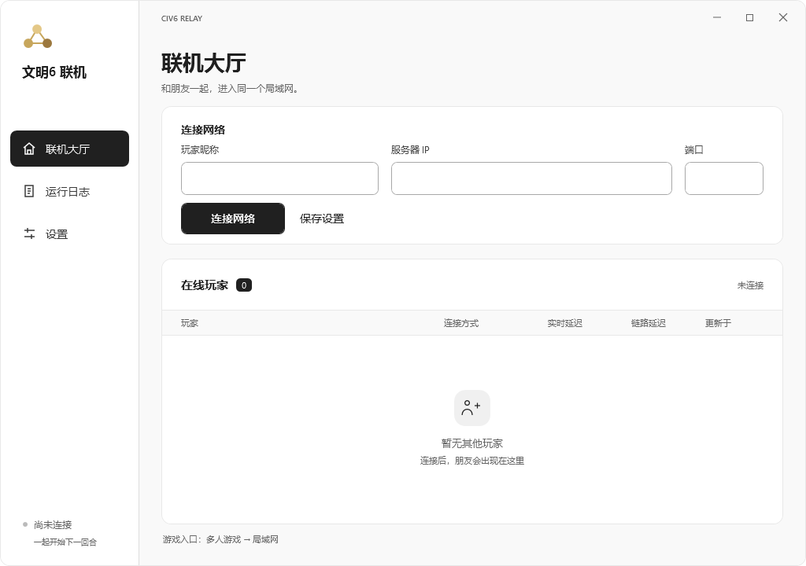
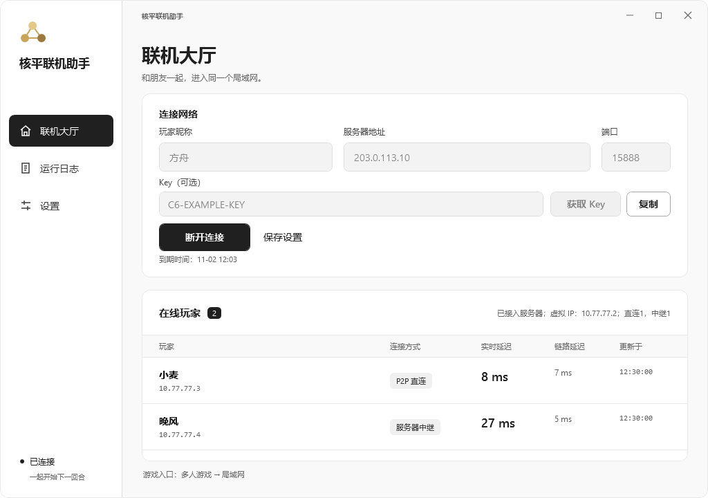
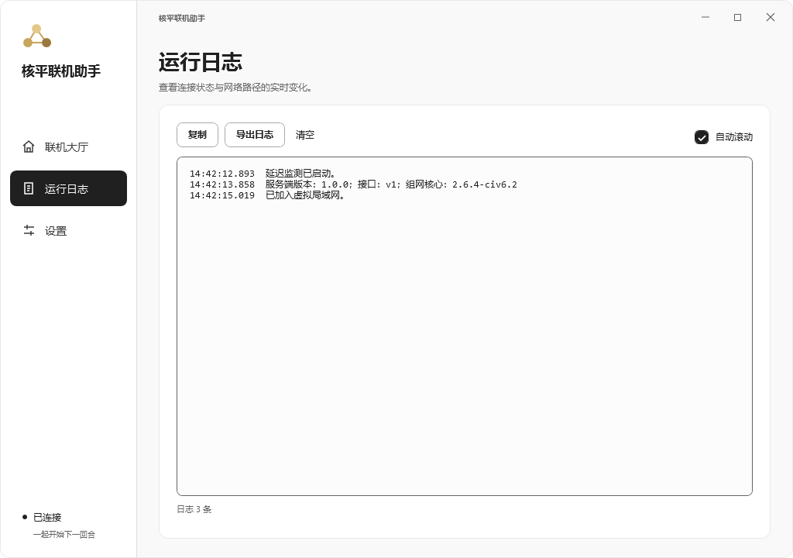
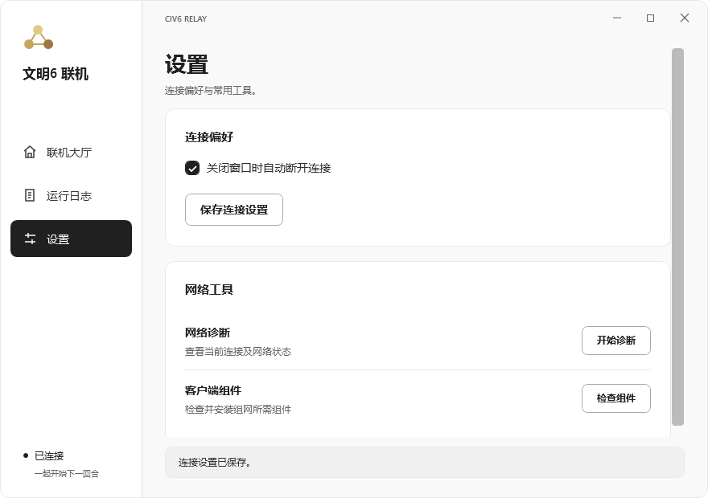

# 核平联机助手

让 Windows 玩家通过虚拟局域网联机：优先玩家直连，无法直连时由自己的 Linux 服务器中继。在文明6中选择 **多人游戏 → 局域网**，即可一起建房、加入游戏。

[下载 1.0.0](https://github.com/FLF-Gamer/civ6-relay/releases/tag/v1.0.0) · [玩家使用](#windows-快速开始) · [服务端部署](#服务端部署) · [源码构建](#源码构建)



客户端提供 **黑白** 与 **文明6** 两套主题，可在 **设置 → 外观** 即时切换并自动保存。文明6主题使用深灰蓝侧栏、柔和金色选中项与羊皮纸背景。主题说明见 [外观主题](docs/client-themes.md)。下方截图展示黑白主题。

截图中的昵称、IP 和延迟均为演示数据。

## Windows 快速开始

适用于 **Windows 10/11 x64**。免费与 Key 模式使用同一份通用 Windows 客户端。

1. 下载并完整解压 Windows 客户端，向服务器搭建者确认地址和 HTTP 接入端口，默认 `15888`。
2. **完整解压 ZIP**，在解压后的文件夹中双击 `Civ6Relay.exe`，允许管理员权限。保留同目录的其他文件。
3. 填写自己的玩家昵称、服务器 IP 和端口，点击 **连接网络**。昵称支持中文；首次启动时这三个输入框均为空。
4. 在“在线玩家”中确认能看到朋友，再进入文明6的 **多人游戏 → 局域网**。由一人建房，其他人刷新房间列表并加入。
5. 游戏结束后，点击 **断开连接**。

连接成功后，主按钮会切换为“断开连接”；昵称、服务器 IP 和端口暂时锁定，断开后可以修改。点击“保存设置”可保存这三项，下次启动自动读取。

服务器会返回实际组网配置，玩家填写接入端口即可。管理员导出的专用 `windows.zip` 也支持填写组网端口直接连接。

## Key 接入

服务器提供 Key 接入时，填写地址和接入端口，点击 **获取 Key**，或直接填入朋友提供的 Key 后连接。一起联机的玩家填写同一个 Key。不需要 Key 的服务器可以留空连接；主动获取时提示“此服务器无需 Key。”。

Key 模式默认关闭，由服务器管理员显式开启。Key 由所填服务器签发，有效 48 小时；当前未接入支付。自建服务器保留免费使用方式。部署、端口与使用说明见 [可选 Key 服务](docs/key-access.md)。

## 客户端界面

### 在线玩家与实时延迟



联机大厅会实时更新玩家列表，显示每位玩家的昵称、虚拟 IP、连接方式和延迟。

连接期间，大厅每 10 秒更新服务器的组网房间数量、CPU、内存和上下行速率。组网房间对应共享虚拟局域网，Key 模式下每个有效 Key 对应一个房间。状态接口说明见 [服务器状态](docs/key-access.md#服务器状态)。

| 项目 | 含义 |
| --- | --- |
| P2P 直连 | 游戏数据在玩家之间直接传输。 |
| 服务器中继 | 无法直连时，通过服务器转发游戏数据，会占用服务器带宽。 |
| 实时延迟 | 测量到对方虚拟 IP 的往返延迟；没有回应不等于游戏一定不通。 |
| 链路延迟 | 当前链路的延迟；中继时只代表到中继节点的延迟。 |
| 更新于 | 本次延迟采样的时间。 |

虚拟网络承载游戏 UDP 和 ICMP，仅为游戏网段添加路由。普通上网和下载保持本地网络。

### 运行日志



通过左侧“运行日志”查看连接状态与网络路径的实时变化。日志支持 **复制、导出、清空和自动滚动**，方便保存并分享排查信息。

### 设置与网络工具



- **外观**：选择黑白或文明6主题，立即生效，重启后保留选择。
- **关闭窗口时自动断开连接**：默认开启；取消后，关闭窗口会保留组网进程。该开关只对本次运行生效。
- **保存连接设置**：保存联机大厅填写的昵称、服务器 IP 和端口。
- **网络诊断**：点击“开始诊断”，查看当前连接、玩家路径、广播和防火墙等信息。
- **检查组件**：检查并安装或修复组网所需组件；需要替换组件时，先断开连接。
- **关于与更新**：查看客户端版本，点击 GitHub 地址打开项目主页，或点击“下载新版”进入 Releases。
- **查询服务端版本**：查询大厅中所填服务器的 HTTP 接入端口，不需要昵称或 Key，也可在连接期间查询。旧服务器未提供接口时会明确提示。

诊断和检查结果显示在窗口底部，并写入运行日志。排查问题时可复制完整诊断结果，并注明谁建房、谁看不到房间。

窗口支持缩放和高 DPI 屏幕，也可通过左侧导航随时切换联机大厅、日志和设置。

## 服务端部署

### 系统要求

- Linux x86_64，使用 systemd 管理服务。
- 系统 Python 3.6 或更新版本，路径为 `/usr/bin/python3`。
- 已安装 `ip`、`firewall-cmd`、`systemctl`，且 firewalld 正在运行。
- 可供玩家访问的公网 IPv4，以及空闲的接入和组网端口。

安装器按这些条件检查环境，不限定发行版名称。默认使用其他防火墙管理工具的系统，需要先确认 firewalld 的配置与现有规则兼容。

### 全新安装

从 [Releases](https://github.com/FLF-Gamer/civ6-relay/releases) 下载完整服务端安装包，可直接在服务器下载，也可通过 SCP 或 SFTP 上传。

Release 完整安装包已包含服务端和 Windows 组件，推荐用于部署。Git 仓库保存源码和构建脚本，源码包需要另行准备组件后才能安装。

在服务器上执行：

```bash
curl -fLO https://github.com/FLF-Gamer/civ6-relay/releases/download/v1.0.0/civ6-relay-server-1.0.0-linux-amd64.tar.gz
tar -xzf civ6-relay-server-1.0.0-linux-amd64.tar.gz
cd civ6-relay
sudo bash install.sh --endpoint SERVER_IP --port 9527 --api-port 15888
sudo civ6-relay status
```

将 `SERVER_IP` 替换为服务器的公网 IPv4。`--api-port` 是玩家填写的 HTTP 接入端口；`--port` 是免费模式下的组网端口，两者可分别修改。

云安全组或云防火墙需放行 **15888/TCP** 和 **9527/TCP、UDP**。安装器会在 firewalld 中放行配置的端口，保留已有规则。管理端口 `15887` 仅监听本机回环地址。

安装成功后，一个 `civ6-relay.service` 同时管理 HTTP 接入和一个组网进程，并设置开机启动。多个 Key 房间在该组网进程内独立运行。程序位于 `/opt/civ6-relay`，接入与 Key 设置位于 `/etc/civ6-relay/service.json`。

启用 Key 模式时使用同一安装命令，增加 `--enable-key`。详细配置见 [Key 服务](docs/key-access.md)。

### 导出并分发客户端

使用通用客户端时，玩家下载公开 Windows ZIP 即可。需要包含本服务器接入信息的专用 ZIP 时，执行 `sudo civ6-relay bundle`，默认生成：

```text
/etc/civ6-relay/exports/windows.zip
```

将这个 ZIP 私下发给联机玩家，并告知服务器 IP 和端口。同一服务器的所有玩家使用同一份 ZIP，各自在客户端填写昵称。

**导出的 Windows ZIP 包含本服务器的共享接入信息，仅供私下分发。公开 Release 使用不含接入配置的客户端模板。** `/etc/civ6-relay` 中的配置和密钥属于私有部署数据。公开服务端安装包不包含已部署服务器的接入信息。

再次导出时不会覆盖已有文件，请指定新的输出路径：

```bash
sudo civ6-relay bundle --output /root/windows-new.zip
```

再次导出沿用服务器现有接入信息和已安装的客户端模板。

## 维护与排查

查看服务和已接入玩家：

```bash
sudo civ6-relay status
sudo systemctl status civ6-relay.service
```

| 问题 | 排查方法 |
| --- | --- |
| 无法连接服务器 | 检查服务器 IP、客户端端口、云安全组和 firewalld，确认同一端口的 TCP、UDP 都已放行。 |
| 看不到朋友 | 确认双方连接同一服务器；Key 模式下使用同一个 Key，并且都已连接。 |
| 看不到局域网房间 | 确认文明6选择“局域网”，游戏版本、DLC 和模组兼容，并允许文明6通过 Windows 防火墙。 |
| 组件缺失或损坏 | 先断开，再到“设置”中点击“检查组件”。 |
| 更换客户端版本 | 先断开旧版，再完整解压并使用新版。 |

当前安装脚本用于全新安装：检测到已有配置或服务时会停止，尚无原地升级命令。重复执行安装脚本不会覆盖现有接入信息。

卸载服务及本工具配置：

```bash
sudo civ6-relay uninstall
```

卸载会停止服务，删除服务器接入信息和导出的客户端包，并移除本工具新增的防火墙端口；原有规则及程序目录保留。

## 源码构建

完整构建需要 Python 3、Docker（命令在 PATH 中）和下载构建依赖的网络。依次准备组件、构建启动器，再生成公开发布包：

```bash
python3 scripts/build-deps.py
python3 scripts/build-mesh-fork.py
python3 scripts/build-launcher.py --verify-reproducible
python3 scripts/package.py --output-dir .build/release-public
```

启动器默认复用组网组件构建生成的 `civ6-mesh-build:local` 镜像和 Windows SDK 缓存，离线构建。生成的 `client/windows/Civ6Relay.exe` 不提交到 Git，由打包脚本加入发布包。

也可在 Windows x64 上单独构建启动器：安装 Python 3、Rust 1.95.0（MSVC 工具链）以及 Visual Studio Build Tools 的“使用 C++ 的桌面开发”（含 MSVC 和 Windows SDK），执行：

```powershell
$env:RUSTUP_TOOLCHAIN = '1.95.0'
python scripts/build-launcher.py --native --verify-reproducible
```

`--native` 使用本机编译器和 SDK，不使用 Docker。完整发布包仍需前述 Linux、Windows 组网组件；公开打包时省略 `--profile`，该参数用于生成包含私有接入配置的客户端。

第三方组件源码、补丁和许可证见 Release 安装包内的 `vendor/easytier/licenses`、`vendor/linux-amd64/licenses` 与 `client/windows/licenses`。
