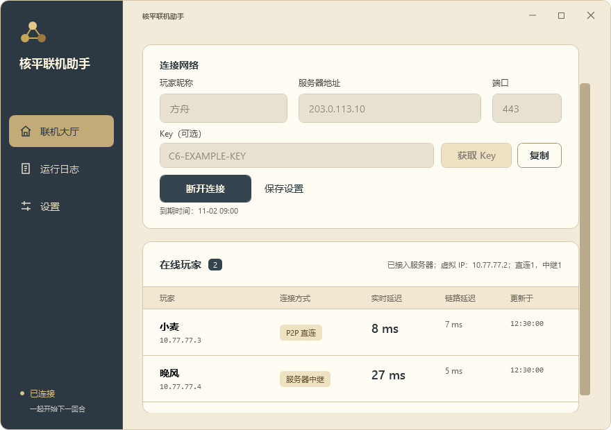

# 客户端主题

核平联机助手提供两套主题：

| 主题 | 配色 |
| --- | --- |
| 黑白 | 原有黑白灰界面，黑色主按钮和选中项 |
| 文明6 | 深灰蓝侧栏、柔和金色选中项、浅羊皮纸背景与暖白输入框 |

在 **设置 → 外观** 选择，立即生效并自动保存。首次启动默认使用黑白，之后沿用上次选择。连接期间也可切换，不会重新连接网络。

截图由实际 Windows WPF 客户端生成，玩家、地址和延迟使用演示数据。

大厅、玩家列表、日志、设置、按钮、输入框和操作提示共同使用主题资源。应用图标及原有品牌标记独立于界面主题。

主题选择单独保存在 `%ProgramData%\Civ6RelayMesh\appearance.json`。选择主题无需先填写昵称、服务器或 Key；不会修改这些连接设置。主题文件丢失、损坏或包含不支持的名称时使用黑白主题。

配色定义位于 `client/windows/Themes.json`，WPF 控件使用动态资源。切换时更新一次画刷资源；网络和延迟采样不读取主题文件。

## 本次验证

- PowerShell 验证主题保存和读取、未填写连接设置时的选择、独立配置与损坏文件恢复。
- 检查两套配色和所有 XAML 动态资源完整、黑白默认值一致。
- Windows PowerShell 5.1 中运行实际 WPF 界面，验证连接中切换主题、恢复黑白、动态画刷、导航和缩小窗口后的布局。
- 打包和安装检查要求携带 `Themes.json`，个人外观设置不进入公开包。

1.0.0 的 [Windows 验证](https://github.com/FLF-Gamer/civ6-relay/actions/runs/41409888354) 已通过，包含两套主题的实际 WPF 截图。界面测试使用模拟连接数据，没有启动文明6。
